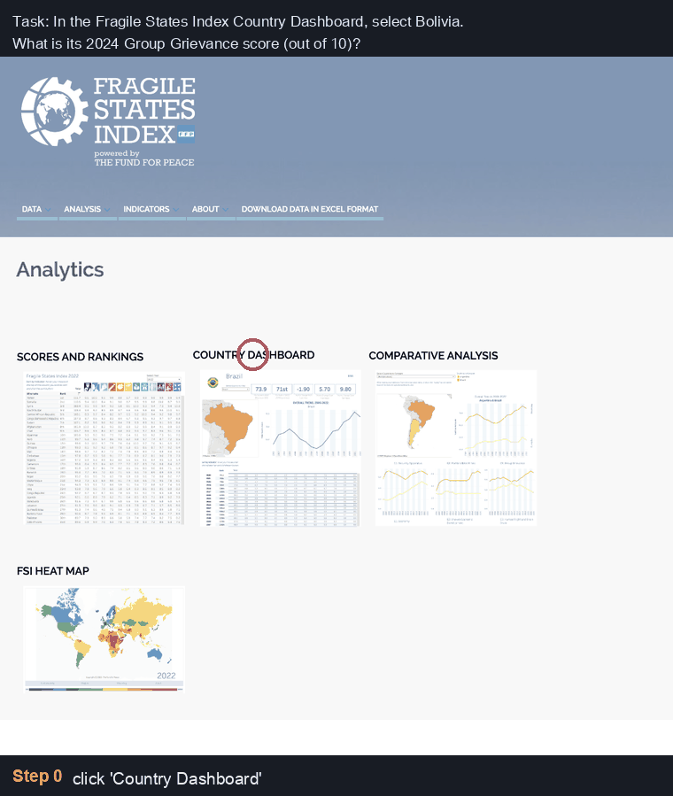

# WebFovea

English | [中文](README_zh.md)

**When the model is right but the click is wrong.** WebFovea is a vision-based web agent that answers questions by operating live websites through their own interface: it looks at screenshots, clicks, types and scrolls, and returns a verifiable answer. It placed **2nd in the [WebRetriever Challenge 2026](https://mininglamp-ai.github.io/WebRetriever_Challenge/)** with a final score of **57.0 / 100**.

[](https://github.com/jianganghan/WebFovea/actions/workflows/tests.yml)
[](https://arxiv.org/abs/2610.03036)
[](LICENSE)

<p align="center"></p>
<p align="center"><sub>Selected steps from one 25-step episode on a live site (the case study in Section 4 of the report).</sub></p>

## Why this exists

A capable multimodal LLM is necessary for a web agent, but not sufficient. The model's decisions reach the browser through the *harness*, the code between the model and the page. At every step, four things must go right:

| Stage | What goes wrong on real websites (from our runs) | What WebFovea does |
|---|---|---|
| **Parsing** | chat-template tokens like `<\|eot_id\|>` typed into search boxes (4.9% of episodes); an invented multi-step trajectory with a fake final answer | keep only the first action; strip special tokens and stray trailing markup |
| **Execution** | every click landing at 3/4 of its intended coordinates; native dropdowns that clicks cannot operate; keystrokes lost to the wrong focus; clicks swallowed inside iframes | coordinate-space alignment; `select`; `fill`; Enter on trailing newline; DOM click fallback inside iframes |
| **Feedback** | a click that worked inside an iframe reported as "no change", so the model abandoned it; failed inputs invisible in the screenshot | DOM and child-frame fingerprints; notes naming the element under the click; `fill` read-back; tooltip text hash |
| **Observation** | values that only appear on hover; targets far down long pages; digits hidden by custom fonts | screenshot size cap; `hover`; `find_text`; `read_text`; rule-based triggers |
| **Guardrails** | shortcuts through URLs and data APIs; endless repetition; tasks lost to a crashed worker or a failed API call | closed action set; hard constraints; budgets enforced by the executor; scroll breaker; retries and shared-queue dispatch |

The same model (`claude-opus-4-6`) was used in all four official submissions. The score rose from 31.0 to 57.0 through harness changes alone, up to run-to-run variance on live sites:

| Submission (2026) | Hidden-set score | Main additions |
|---|---:|---|
| Aug 29 | 31.0 | coordinate alignment, `select`, `hover`, `reload`; closed action set, hard constraints |
| Aug 31 | 41.0 | `find_text`, `back`; shared-queue dispatch |
| Sep 1 | 46.0 | token stripping; `fill`, Enter on newline; `read_text`; scroll-breaker fix |
| Sep 2 | **57.0** | iframe fallback; `find_text` / `read_text` search child frames; 80 steps; model-call retries |

The full design, the evidence for each component (including negative results) and a failure analysis are in the [technical report](https://arxiv.org/abs/2610.03036).

## Quick start

Requirements: Python 3.10+, Chromium via Playwright, an Anthropic API key. Developed on macOS; CI runs the tests on Linux.

```bash
git clone https://github.com/jianganghan/WebFovea.git && cd WebFovea
pip install -r requirements.txt    # or: conda env create -f environment.yml
playwright install chromium

# The key is read from the environment only, never from config.json
export VLM_API_KEY=sk-ant-...
bash scripts/run_local.sh data/example_tasks.json runs/demo
```

`run_local.sh` starts Playwright's Chromium with remote debugging on, runs the agent against it and writes one folder per task to `runs/demo/`:

```
runs/demo/<task_idx>_<task_id>/
├── result.json        # agent_answer, actions, thoughts, visited URLs, status
├── trajectory/*.png   # the screenshot the model saw at each step
└── capture.json       # network requests made during the episode
```

Run several tasks in parallel with one browser each: `bash scripts/run_local.sh tasks.json runs/x 4`. Close the browsers with `bash scripts/run_local.sh --kill`.

**Cost.** Each step sends the five most recent screenshots, so input dominates: about 10.6k input and 127 output tokens per step on average. A 100-task run with `claude-opus-4-6` cost about $170–230. Try a few tasks first.

### Evaluate on the public Protocol III tasks

The 100 public Protocol III tasks are in the [WebRetriever dataset](https://huggingface.co/datasets/Mininglamp-2718/WebRetriever) on Hugging Face (gated, CC BY 4.0). They come with reference answers:

```bash
bash scripts/run_local.sh path/to/protocol3.json runs/p3 4
# add --fuzzy to let an LLM judge answers the rule tiers reject
python eval/score.py --runs runs/p3 --gold path/to/protocol3.json
```

`eval/score.py` approximates the official metric with rule-based tiers (exact, date, numeric) and an optional LLM judge. The official scorer used an LLM judge plus manual review, and some public reference answers have gone stale as sites changed, so **local numbers are not comparable with leaderboard numbers**. WebFovea was developed on these public tasks; the official 57.0 is on a separate hidden set.

## Configuration

`config.json` holds the model endpoint and every agent switch, exactly as submitted (minus the API key):

| Key | Default | Stage |
|---|---|---|
| `api_base`, `api_model` | Anthropic's OpenAI-compatible endpoint, `claude-opus-4-6` | – |
| `max_steps`, `task_budget_s` | 80, 1800 s | Guardrails |
| `max_backs_per_task`, `max_find_text_per_task`, `max_read_text_per_task` | 15, 10, 5 | Guardrails |
| `model_call_max_attempts`, `model_call_retry_budget_s` | 6, 240 s | Guardrails |
| `enable_fill`, `enable_type_newline_submit`, `enable_iframe_click_fallback` | on | Execution |
| `enable_find_text`, `enable_read_text` | on | Observation |
| `settle_floor_ms`, `settle_ceil_ms` | 1000, 8000 | Observation |
| `enable_click_many` | on (image-grid CAPTCHAs only) | Execution |
| `enable_provenance_rule` | off in the submitted version (experimental prompt rule) | – |

Every key can be overridden with an environment variable named `WEBFOVEA_<KEY>` (e.g. `WEBFOVEA_MAX_STEPS=40`); priority is environment variable > `config.json["agent"]` > code default, and `src/agent/runtime_config.py` documents why each value is what it is. Any OpenAI-compatible endpoint can be set in `api_base` / `api_model`, but the prompts, the coordinate handling and the token stripping were tuned for `claude-opus-4-6`.

## Repository layout

```
src/agent/
├── main.py             # task runner: workers, per-task budgets, results
├── task_dispatch.py    # shared task queue with crash compensation
├── agent.py            # model call, reply parsing, coordinate mapping
├── prompts.py          # action space and hard constraints
├── web_controller.py   # executor: actions, feedback, iframe fallback
└── runtime_config.py   # every tunable, with the reasoning behind it
scripts/
├── run_local.sh        # start Chromium, then run the agent
├── run.sh              # run against browsers that are already running
└── launcher.py         # same conditions on any machine
eval/score.py           # local scorer for Protocol III answers
tests/                  # 270+ offline tests, zero tokens
```

`src/agent/` is the agent that scored 57.0 in the challenge.

## Tests

```bash
python -m unittest discover -s tests -v
```

The tests run without a browser, network or model. They focus on failures that are silent in a real run: an action described in the prompt but not wired into the parser or executor, listeners leaking across tasks, a worker crash that quietly drops tasks, a config typo that changes behaviour. See [tests/README.md](tests/README.md).

## Limitations

- **One model.** All results use `claude-opus-4-6`. The four-stage view is model-agnostic, but some fixes (coordinate alignment, token stripping) address problems specific to this model and its API.
- **Live websites.** Sites change, block automation or are unreachable from some networks; repeated runs of the same version vary.
- **Built for a benchmark.** The agent answers information-retrieval questions. Its hard constraints keep it on the given site and forbid navigating by URL; it is not designed for tasks that log in or have side effects.

## Roadmap

From the report's future work, roughly in order of expected payoff relative to effort:

- **Route steps to different models.** Steps differ in what they need: locating a control, reading a dense table, deciding when to stop. Each step can go to a large or small multimodal model, a rule, or a classical vision routine, while the four stages and the guardrails stay the same.
- **Classical computer vision for feedback and observation.** OCR to cross-check values read from screenshots, perceptual-hash change detection for canvas and image updates the DOM fingerprint cannot see, and template matching for recurring widgets.
- **An independent answer verifier.** Before `finished`, a separate model call with a fresh context sees only the task, the final screenshot and the candidate answer, and checks it, targeting wrong-row and wrong-table errors.
- **Native API with prompt caching and tool-use actions.** Outside the challenge's API constraints, this would cut cost by an estimated 55-70% and remove free-text parsing, and with it most parsing failures.
- **Hybrid observation.** A list of interactive elements with coordinates alongside the screenshot, A/B-tested, since hybrids are not automatically better.
- **Download-and-parse and task-type skills.** Read PDF and spreadsheet sources directly, and give the agent short per-category checklists plus per-site operating notes.
- **Synthetic tasks and fine-tuning.** Generate tasks with programmatic ground truth on the same sites and distill teacher trajectories into a smaller open model, to cut cost and internalize the prompt rules.

Ideas and pull requests on any of these are welcome.

## Citation

```bibtex
@misc{han2026webfovea,
  title  = {{WebFovea}: When the Model Is Right but the Click Is Wrong --
            Reliable Round Trips for Vision-Based Web Agents on Live Websites},
  author = {Jiangang Han},
  year   = {2026},
  eprint = {2610.03036},
  archivePrefix = {arXiv},
  primaryClass = {cs.LG},
  url    = {https://arxiv.org/abs/2610.03036},
}
```

## Acknowledgments

WebFovea started from the reference implementation of the [WebRetriever](https://github.com/Mininglamp-AI/WebRetriever) benchmark by Mininglamp Technology (MIT), which uses the [UI-TARS](https://github.com/bytedance/UI-TARS) action format. Thanks to the WebRetriever Challenge organizers for the benchmark and the evaluation infrastructure.

## License

[MIT](LICENSE).
